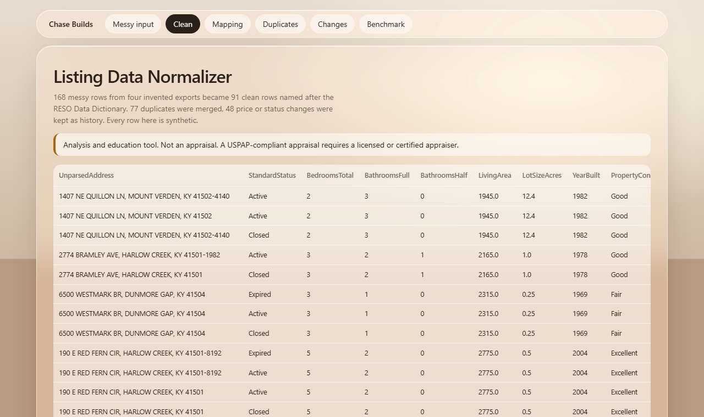

# listing-data-normalizer

[](https://github.com/chasebuilds/listing-data-normalizer/actions/workflows/ci.yml)  [](LICENSE)

Cleans messy residential property exports into one table: MLS-style listing exports, county assessor CSVs and spreadsheet comps lists (CSV or Excel). Column names in the output follow the public [RESO Data Dictionary](https://www.reso.org/data-dictionary/) (`ListPrice`, `ClosePrice`, `LivingArea`, `BedroomsTotal`, `StandardStatus` and so on). Headers are mapped with a review sheet, units are converted, bed/bath text is parsed, addresses are standardized, the same property across sources is merged, price changes are kept as history, and prices far from the neighborhood are flagged. Everything runs offline.

**Live demo (synthetic data only):** https://chasebuilds.github.io/listing-data-normalizer/



> **Not an appraisal.** This is an analysis and education tool for tidying data. A USPAP-compliant appraisal requires a licensed or certified appraiser. Nothing here estimates value or replaces that work.

## Measured result

Four invented exports with known answers (two MLS styles, a county assessor file, an Excel comps list) were run through the tool and scored. The table is written by the benchmark script from a real run. Method, misses and limits: [BENCHMARK.md](BENCHMARK.md). The data was invented by the same author as the parsers, so treat the field accuracy as a regression guard. A real export has formats this generator never thought of; those go to the Review sheet.

<!-- benchmark:start -->
| Measure | Result |
|---|---:|
| Rows in (4 files, 3,000 fake houses) | 12,269 |
| Headers mapped to the right RESO field | **100.0%** (56 of 56) |
| Fields right, exact (rows where the source had a value) | **100.0%** (159,352 of 159,352) |
| Rows with every scored field right | 100.0% |
| Junk values left blank | 100.0% (717 of 717) |
| Junk rows flagged in Review | 100.0% |
| Duplicate pairs found (recall) | **98.8%** (6,773 of 6,855) |
| Duplicate pairs that were right (precision) | **98.4%** (6,773 of 6,885) |
| Merged rows that match one true event exactly | 85.3% |
| Off-market rows found (recall) | **78.0%** (163 of 209) |
| Of those, rows priced off-market on purpose that were found | 85.8% (133 of 155) |
| Outlier flags that were right (precision) | **62.5%** (163 of 261) |
<!-- benchmark:end -->

## What it does

| Step | Example in | Example out |
|---|---|---|
| Header mapping, with a review sheet | `MLS #`, `GLA (m2)`, `Sale $`, `Bed/Bath` | `ListingId`, `LivingArea`, `ClosePrice`, bed and bath fields (method and confidence in the Mapping sheet) |
| Units | `172 sq m`, `0.25 ac`, `10,890 sqft`, `75x145` | `LivingArea` 1851.4 sq ft, `LotSizeAcres` 0.25 and `LotSizeSquareFeet` 10890 |
| Bed and bath | `3/2.5`, `3 BR 2 BA`, `3 bed 2 full 1 half`, `3/2/1` | `BedroomsTotal` 3, `BathroomsFull` 2, `BathroomsHalf` 1, `BathroomsTotalInteger` 3 |
| Year built | `c. 1950`, `Built in 2003`, `New construction` | 1950, 2003, blank and sent to Review |
| Condition | `Like new`, `Dated, needs updating`, `Sold as-is`, `F` | `Excellent`, `Fair`, `Poor`, `Fair` |
| Price | `$249.9K`, `249,900.00`, `call agent` | 249900, 249900, blank and sent to Review |
| Date | `3/4/25`, `Mar 4, 2025`, `04-Mar-25`, `20250304`, Excel serials | 2025-03-04 |
| Address | `123 north main Street Apt 4B` | `123 N MAIN ST # 4B` (`UnitNumber` 4B) |
| Same property, many sources | one sale seen in MLS, assessor and comps | one row, `X_SourceCount` 3, the extra rows listed in Duplicates |
| Price history | list, price cut, sold | three rows in Clean, two rows in Changes with dollar and percent change |
| Outliers | a house at $30 per sq ft in a ZIP that sells near $110 | `PPSF_LOW` in `X_Flags` |

## Quick start

Windows (on macOS or Linux use `.venv/bin/` in place of `.venv\Scripts\`):

```
python -m venv .venv
.venv\Scripts\python -m pip install -e ".[parquet]"
.venv\Scripts\listnorm clean samples\mls_a.csv samples\mls_b.csv samples\county_assessor.csv samples\comps_list.xlsx -o out
```

The samples are 168 generated rows for 40 invented houses (`python -m benchmark.synth` rebuilds them; `truth.json` holds the answers). The first file listed wins when sources disagree. The command prints:

```
168 rows in, 91 clean rows out
77 duplicate rows merged, 48 changes kept as history
...
```

It writes `clean.csv`, `clean.parquet` (needs the `parquet` extra) and `listings.xlsx` with the sheets Clean, Review, Duplicates, Changes, Mapping and About.

A header the tool does not know can be mapped with a two-column CSV:

```
listnorm clean export.csv --mapping my_headers.csv -o out
```

```
source_header,field
Prop Cond,PropertyCondition
```

Python:

```python
from pathlib import Path
from listing_data_normalizer.core import normalize, write_outputs

result = normalize([Path("mls.csv"), Path("assessor.csv")])
print(result.summary)
write_outputs(result, Path("out"))
```

## The sheets

- **Clean**: one row per listing or sale event, after duplicates are merged. `X_PropertyKey` groups the events of one property. `X_Flags` holds `PPSF_HIGH`, `PPSF_LOW`, `AREA_IMPLAUSIBLE`, `FIELD_CONFLICT`, `STATUS_INFERRED` and `ATTR_FILLED:<field>`.
- **Review**: every value that could not be read, with the source file, row, raw text and reason. Nothing is guessed silently: a bad value is left blank.
- **Duplicates**: each merged row, the row it was merged into, why, and any fields where the sources disagreed.
- **Changes**: for each property, the step from one event to the next (list price change, sold after listing, relisted under a new ID, sold again) with dollar change, percent and days.
- **Mapping**: each source header, the RESO field it was mapped to, how (exact, fuzzy, override, duplicate, unmapped) and a confidence.

## Schema

Field names come from the public RESO Data Dictionary and nothing else is borrowed from it: `ListingId`, `ParcelNumber`, `UnparsedAddress`, `StreetNumber`, `StreetDirPrefix`, `StreetName`, `StreetSuffix`, `StreetDirSuffix`, `UnitNumber`, `City`, `StateOrProvince`, `PostalCode`, `CountyOrParish`, `SubdivisionName`, `PropertyType`, `PropertySubType`, `StandardStatus`, `BedroomsTotal`, `BathroomsFull`, `BathroomsHalf`, `BathroomsTotalInteger`, `LivingArea`, `LivingAreaUnits`, `LotSizeSquareFeet`, `LotSizeAcres`, `YearBuilt`, `PropertyCondition`, `OriginalListPrice`, `ListPrice`, `ClosePrice`, `TaxAssessedValue`, `ListingContractDate`, `CloseDate`. Columns starting `X_` are this tool's own and are not RESO fields. The value sets for status, subtype and condition are small lists written for this tool, not a copy of any MLS's lookups; see [LIMITATIONS.md](LIMITATIONS.md).

## Development

```
.venv\Scripts\python -m pip install -e ".[dev]"
.venv\Scripts\python -m ruff check .
.venv\Scripts\python -m mypy
.venv\Scripts\python -m pytest
.venv\Scripts\python -m benchmark.run_benchmark
```

CI runs ruff, mypy in strict mode and pytest on Python 3.11 and 3.13.

## Limits

Read [LIMITATIONS.md](LIMITATIONS.md) before trusting a cleaned file. Short version: no geocoding, no fuzzy address matching, US dates assumed month first, price history needs a date on every row, and neighborhood outlier checks compare by subdivision or ZIP only.

## Data and license

All sample and benchmark data is synthetic: invented streets, towns, parcel numbers and prices. No real owner, address or sale appears anywhere. Code is MIT, copyright Chase Builds. RESO and the RESO Data Dictionary belong to the Real Estate Standards Organization; this project only uses the public field names and is not affiliated with or certified by RESO.
